<!-- SPDX-License-Identifier: Apache-2.0 -->
# Impulse Evals

**Automated voice-to-voice testing, tool-call verification, and CI gates for AI agents.**

Stop testing voice agents with manual phone calls or text-only mocks. Impulse Evals simulates real callers (with TTS/STT audio and background noise), grades conversations against your agent's own system prompt, and generates playable HTML audio reports—100% locally or in CI.

<p align="center">
  
</p>

<!--
  VIDEO PLACEHOLDER: in the GitHub web editor, drag and drop docs/images/report-walkthrough.mp4 onto this line.
  GitHub uploads it and inserts a https://github.com/user-attachments/assets/... URL on its own line,
  which renders as an inline video player. Then you can delete the fallback link below.
  A copy was already uploaded once; to reuse it, paste this URL on its own line instead:
  https://github.com/user-attachments/assets/a7272d6c-41a7-4efa-af84-4b815421a5e6
-->

**[Watch the report walkthrough (MP4)](docs/images/report-walkthrough.mp4)**: the call recording, failed checks with "Hear turn N" links, slow replies in red, and the failing turn highlighted.

> [!TIP]
> Using Claude? Install the Impulse Evals skill ([docs/skill.md](docs/skill.md)) and ask it to write your `config.yaml`.

## 60-second quickstart (no API key needed)

Requires Python 3.11 or newer.

```bash
git clone https://github.com/Impulse-Eval/impulse-eval
cd impulse-eval
pip install -e .
impulse run examples/config.yaml --dry-run
```

**What success looks like:** the command exits with code `0`, prints `6 scenarios, 6 passed, 0 failed`, and writes `.impulse/runs/<run_id>/report.html`. Open it in a browser. The dry run talks to a tiny echo agent with a scripted caller and makes zero LLM calls: it proves the install and config work, and skips the judge.

Only need the package, not the examples? `pip install "git+https://github.com/Impulse-Eval/impulse-eval"`.

### Your first real run

```bash
impulse init                          # pick a language and a LiteLLM model per role; writes .impulse/config.toml
impulse doctor examples/config.yaml   # exits 2 until no row says FAIL
impulse run examples/config.yaml      # exit 0 = pass, 1 = --fail-on condition met, 2 = config error
```

**No paid API key?** [Run Impulse for free](docs/run-for-free.md) with Ollama for the language models and local speech models for voice. Impulse sends no telemetry; your system prompt and transcripts go only to the providers you configure ([Privacy and security](docs/privacy-and-security.md)).

## Why Impulse Evals?

| | |
|---|---|
| **Any stack** | LiveKit and Pipecat (Impulse joins your running agent as a client), HTTP/JSON for an agent in any language, a plain Python function (`generic`), or a `custom` adapter class for Vapi, Retell or an in-house platform. |
| **Zero-rubric LLM judge** | Grades every conversation against your agent's own `system_prompt.txt` plus a small universal safety floor. No rubric to write, no domain-specific judge code. Every language and accent is reported as its own cohort. |
| **Tool-call & hallucination checks** | `UNIV-025` checks expected and forbidden tool calls and their arguments, deterministically, in code. `UNIV-019` and `UNIV-023` flag a "you're booked" after a failed or missing booking call, misleading claims, and credential requests. |
| **Honest agent latency** | Latency is measured on your agent only, never on Impulse's own TTS or STT time. |
| **Playable audio reports** | One self-contained `report.html` per run: the full call audio, a player per turn, slow replies as red spikes on the timeline, and a "Hear turn N" link on every failed check. |
| **Built-in compliance packs** | For India: DPDP (Digital Personal Data Protection Act), RBI KYC (Reserve Bank of India Know Your Customer rules) and TRAI DLT (the Telecom Regulatory Authority of India's Distributed Ledger Technology registration of commercial calls). An opt-in HIPAA pack covers US healthcare. Technical signals, not legal certification. |
| **CI/CD regression gates** | `--fail-on` exit codes, `impulse compare` to diff two runs and block regressions, and `pytest` helpers (`impulse_check`, `assert_no_critical`). |

## Install extras

Requires Python 3.11 or newer (tested on 3.11, 3.12 and 3.14). Python 3.10 is not supported.

```bash
pip install "impulse-evals[livekit,pipecat,local] @ git+https://github.com/Impulse-Eval/impulse-eval"
```

The extras are `local`, `light`, `voice`, `livekit`, `pipecat` and `dev`; what each adds is in [Getting started](docs/getting-started.md#optional-extras). Package `impulse-evals`, command `impulse`, import package `impulse_evals` (formerly PULSE).

## Documentation

- [Getting started](docs/getting-started.md): install, dry run, first real run, then your own agent
- [Configuration](docs/configuration.md): `config.yaml`, `.impulse/config.toml`, and where models and keys come from
- [Adapters](docs/adapters.md): generic, LiveKit, Pipecat, HTTP and custom; returning `heard_text` and `tool_calls`
- [Run Impulse for free](docs/run-for-free.md): Ollama and local speech models, no API key
- [Metrics](docs/metrics.md): universal, voice and chat metrics, including UNIV-023 and UNIV-025
- [CI integration](docs/ci-integration.md): exit codes, `impulse compare`, GitHub Actions, pytest
- [Verified setups](docs/verified-setups.md): exactly what has been run, with dates and versions
- [Roadmap](ROADMAP.md): what is planned after 0.1.0

More: [docs home](docs/index.md) · [Concepts](docs/concepts.md) · [CLI reference](docs/cli.md) · [Writing scenarios](docs/writing-scenarios.md) · [Cookbook](docs/cookbook.md) (incl. Talk2Neo on LiveKit) · [Compliance packs](docs/compliance-packs.md) · [Voice testing](docs/voice-testing.md) · [Reading the report](docs/reading-the-report.md) · [Calibration](docs/calibration.md) · [Troubleshooting](docs/troubleshooting.md) · [Known limitations](docs/known-limitations.md) · [Architecture](docs/architecture.md) · [FAQ](docs/faq.md) · [Changelog](docs/changelog.md)

## Status

Version `0.1.0`, the first public release (alpha). Dates and versions are in [Verified setups](docs/verified-setups.md).

- **Verified:** real runs with hosted Gemini models against a LiveKit agent and a Pipecat `-t eval` bot, in text and voice; the HTTP adapter; the light local voice; the dry run and the test suite.
- **Experimental:** noise simulation. Its mixer, config and report are verified offline, not yet against a live agent.
- **Not verified:** the free path with Ollama models, `local_hf` speech, LiveKit Cloud, and any other model or provider.

## Contributing

Contributions are welcome: start with [CONTRIBUTING.md](CONTRIBUTING.md), set up with `pip install -e ".[dev]"`, and run `python -m pytest -q`. The most useful help right now is to **[test noise simulation](docs/contributing.md#help-us-test-noise-simulation) on your own voice agent**; testers are added to [CONTRIBUTORS.md](CONTRIBUTORS.md). Report security problems privately ([SECURITY.md](SECURITY.md)), and follow the [Code of Conduct](CODE_OF_CONDUCT.md).

## License

All of Impulse Evals, including the plugin API and the compliance packs, is under the Apache License 2.0 ([LICENSE](LICENSE), [NOTICE](NOTICE)). Use, modify, embed and offer it as a service, commercially too; keep `LICENSE` and `NOTICE` when you redistribute it. Trademark: the licence grants no rights to the "Impulse" name or logo. Plain-language summary: [LICENSING.md](LICENSING.md).

**Need help setting up custom adapters, CI pipelines, or DPDP / RBI KYC / HIPAA compliance suites for your voice agents?** Reach out at **shrikant.s@testvoiceai.live**. Bug reports, feature requests and ideas are welcome there too.
